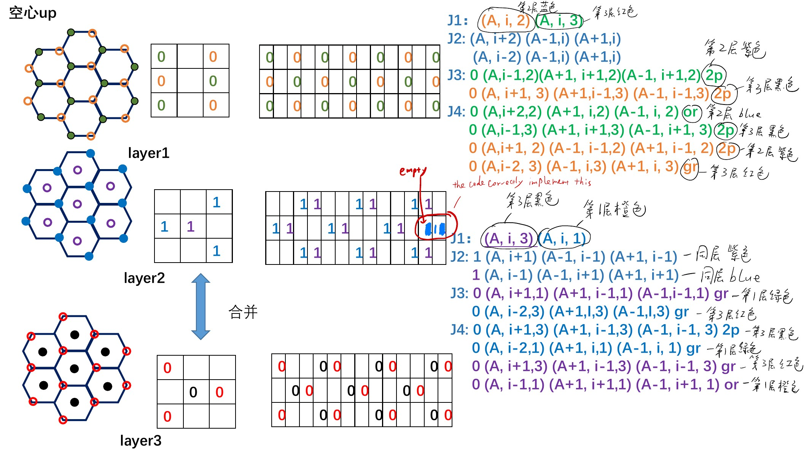

# From colored sites to exchange sums

This guide explains the existing `distrib.m` and `exchangej_.m` implementation
using the author's interpretation of notebook pages 10–11. It does not change
the Class 4, fixed-length LLG/LLGS model or independently establish its physical
crystallography, shell assignments, or material parameters.

Open the [interactive implementation explorer](structure-exchange.html), also
embedded in the [notebook atlas](Alpha-Fe2O3-notebook.html#implementation).
Select a target color, interaction, and boundary position. Select a neighbor
to connect its array position, shift variable, and original source lines.

## 1. Read the structure before reading the shifts



The left-hand sketches identify the colored sites. The square boxes encode
their array positions. The right-hand annotations list neighbors of a target
atom identified by the annotation's color. Page 11 completes the red/black
entries; the explorer switches the source image with the selected target.

Three kinds of labels must remain distinct:

| Notation | Meaning |
|---|---|
| Notebook box labels `0` and `1`, also prefixed to neighbor lists | Labels referring to the square-box representation, as confirmed by the author; not occupancy values or multipliers of the exchange sum |
| `atomtype_(r,c,k)` | `1` for an occupied site; `0` for an empty entry |
| A color mask, e.g. `atomtype_layer1gr(r,c)` | `1` at that color's lateral positions; `0` elsewhere |

An atom drawn with a notebook label `0` still has code occupancy `1`.

Use `(r,c,k)` for **row, column, layer**. The notebook's `(A,i,layer)`
corresponds to this notation. In `exchangej_.m`, the loop variable `i` is
instead the **layer index**. The explorer uses unpadded core coordinates;
MATLAB array rows and columns are each larger by two after padding.

## 2. How `distrib.m` builds the arrays

The following rules are software index rules read from `distrib.m`, not
fractional crystallographic coordinates. Positions advance by four columns.

| Color | Motif layer | Odd core rows: columns | Even core rows: columns | Code mask |
|---|---:|---|---|---|
| Green | 1 | 1, 5, 9, … | 3, 7, 11, … | `atomtype_layer1gr` |
| Orange | 1 | 3, 7, 11, … | 1, 5, 9, … | `atomtype_layer1or` |
| Blue | 2 | 3, 7, 11, … | 1, 5, 9, … | `atomtype_layer2blue` |
| Purple | 2 | 4, 8, 12, … | 2, 6, 10, … | `atomtype_layer2p` |
| Red | 3 | 1, 5, 9, … | 3, 7, 11, … | `atomtype_layer3red` |
| Black | 3 | 4, 8, 12, … | 2, 6, 10, … | `atomtype_layer3black` |

The motif repeats with `mod(k-1,3)`. Blue reuses orange's lateral mask;
red reuses green's; black reuses purple's. These are position relationships,
not identities between atoms in different layers.

For a small core, the first three rows begin as follows (`.` means empty):

```text
             columns 123456789
Layer 1, row 1        G.O.G.O.G
         row 2        O.G.O.G.O
         row 3        G.O.G.O.G

Layer 2, row 1        ..BP..BP.
         row 2        BP..BP..B
         row 3        ..BP..BP.

Layer 3, row 1        R..KR..KR
         row 2        .KR..KR..
         row 3        R..KR..KR
```

`distrib.m` inserts the core into `3:end-2,3:end-2` of a larger array:

```text
requested W × L core → (W+4) × (L+4) array
core (r,c,k)         → padded (r+2,c+2,k)
two empty rows/columns surround every lateral side
```

There is no corresponding layer padding. Layer-boundary omissions are handled
explicitly in `exchangej_.m`.

## 3. Worked example: green target, J3

A green target at `(r,c,k)` couples to three purple sites in layer `k+1`.
For notebook layer 1, these are the three layer-2 coordinates in the green
`J3` annotation.

| Neighbor | Offset `(Δr,Δc,Δk)` | Shifted x array read at target |
|---|---|---|
| `(r,c-1,k+1)` | `(0,-1,+1)` | `mmx_0p1(:,:,i+1)` |
| `(r+1,c+1,k+1)` | `(+1,+1,+1)` | `mmx_n1n1(:,:,i+1)` |
| `(r-1,c+1,k+1)` | `(-1,+1,+1)` | `mmx_p1n1(:,:,i+1)` |

The exact x-component implementation is at `exchangej_.m:38–39`:

```matlab
shift_matx_gr=atomtype_layer1gr.*(mmx_0p1(:,:,i+1)+mmx_n1n1(:,:,i+1)+...
    mmx_p1n1(:,:,i+1));
```

The shift gathers the neighbor value into the target's array position. The
mask selects green **targets**, not purple sources. The source's color follows
from its position and layer occupancy. Lines 40–43 repeat the calculation for
the y and z components. Lines 57–59 combine green and orange target sums.

### Why shift signs look reversed

```matlab
shifted = circshift(spins,[dr,dc]);
% At (r,c,k), shifted reads spins(r-dr,c-dc,k), with array wrapping.
```

Thus `circshift(...,[0,+1])` gathers the column-`c-1` neighbor. The suffix
encodes the **array shift**, not the neighbor displacement. Definitions live
in `integrate_llg.m:91–129`.

## 4. Complete neighbor reference

To keep all 24 combinations readable, define four lateral offset triplets:

| Symbol | Three `(Δr,Δc)` offsets |
|---|---|
| P | `(0,+1), (+1,-1), (-1,-1)` |
| M | `(0,-1), (+1,+1), (-1,+1)` |
| P2 | `(0,+2), (+1,0), (-1,0)` |
| M2 | `(0,-2), (+1,0), (-1,0)` |
| O | `(0,0)` — one neighbor |

`P @ +1`, for example, means all three P offsets in layer `k+1`.
Rows separated by a semicolon in a J4 entry are its two three-neighbor groups.
Line numbers refer to `exchangej_.m`; surface branches are listed separately
below. These are the notebook's neighbor coordinates translated into the
code's repeated motif, with the handwritten destination-color annotations.

| Target | Term | Neighbor color and offset group | Code lines |
|---|---|---|---|
| Green | J1 | Red: O @ -1 | 12–14 |
| Green | J2 | Orange: P2 @ 0 | 18–23 |
| Green | J3 | Purple: M @ +1 | 38–43 |
| Green | J4 | Blue: P2 @ +1; Black: M @ -1 | 78–86 |
| Orange | J1 | Blue: O @ +1 | 8–14 |
| Orange | J2 | Green: M2 @ 0 | 25–30 |
| Orange | J3 | Black: P @ -1 | 50–55 |
| Orange | J4 | Purple: P @ +1; Red: M2 @ -1 | 88–96 |
| Blue | J1 | Orange: O @ -1 | 104–106 |
| Blue | J2 | Purple: P @ 0 | 110–115 |
| Blue | J3 | Red: M2 @ +1 | 131–136 |
| Blue | J4 | Black: P @ +1; Green: M2 @ -1 | 151–159 |
| Purple | J1 | Black: O @ +1 | 104–106 |
| Purple | J2 | Blue: M @ 0 | 118–123 |
| Purple | J3 | Green: P @ -1 | 138–143 |
| Purple | J4 | Red: P @ +1; Orange: M @ -1 | 161–169 |
| Red | J1 | Green: O @ +1 | 182–184 |
| Red | J2 | Black: M @ 0 | 195–200 |
| Red | J3 | Blue: P2 @ -1 | 208–213 |
| Red | J4 | Purple: M @ -1; Orange: P2 @ +1 | 258–266 |
| Black | J1 | Purple: O @ -1 | 178–184 |
| Black | J2 | Red: P @ 0 | 188–193 |
| Black | J3 | Orange: M @ +1 | 220–225 |
| Black | J4 | Blue: M @ -1; Green: P @ +1 | 248–256 |

Layer 1's layer-3 neighbors belong to the preceding motif block; layer 3's
layer-1 neighbors belong to the following block. This is not a wrap from the
last physical layer to the first.

The blue J4 y/z temporaries are named `shift_maty_black` and
`shift_matz_black` (154–159). They use the blue mask and are consumed correctly
at 172–173; the variable names do not change the target color.

## 5. Surfaces and lateral edges

For a stack starting at motif layer 1 and ending at motif layer 3:

| Surface target | J1 count | J2 count | J3 count | J4 count | Boundary code |
|---|---:|---:|---:|---:|---|
| First-layer green | 0 | 3 | 3 | 3 | 7–10, 63–69 |
| First-layer orange | 1 | 3 | 0 | 3 | 45–48, 71–76 |
| Last-layer red | 0 | 3 | 3 | 3 | 177–180, 241–246 |
| Last-layer black | 1 | 3 | 0 | 3 | 215–218, 234–239 |
| Interior, any color | 1 | 3 | 3 | 6 | Interior branches above |

These counts assume the target is away from lateral edges. At lateral edges,
some listed positions lie in the empty padding and contribute zero. Although
`circshift` wraps the allocated array, the two-cell border and maximum lateral
offset of two prevent an occupied core site from coupling to the opposite
occupied edge. The explorer fades absent neighbors instead of drawing them
as real atoms. Blue and purple are never the terminating layers in this stack.
Other stack terminations are not supported by this illustration.

## 6. What the comparison establishes

The audit compared the original PDF pages 10–11 with all six color branches,
all four interactions, and all three component sums. A MATLAB R2024b Update 1
CPU diagnostic used a `5 × 9 × 6` core (140 occupied sites), the actual
`distrib.m`, the actual shift definitions in `integrate_llg.m`, and the actual
`exchangej_.m`. Each occupied site was activated separately with x/y/z probe
amplitudes `1,2,-3`, and every output was compared exactly with direct indexing
of an independently transcribed notebook neighbor table. All comparisons
passed. Directed-bond counts were `114,328,276,544` for J1–J4, with zero
reciprocity mismatches in that finite lattice. This was an operator diagnostic,
not a spin trajectory or GPU benchmark.

This establishes code/notebook agreement on the audited lattice, including
both row parities, both surfaces, interior layers, and lateral edges. Physical
shell distances, crystallographic mapping, and parameter provenance remain
unresolved as described in [model methodology](model-methodology.md).
The exchange Hamiltonian convention in the shared
`presentations/equations/sections/hamiltonian.tex` informed the reciprocity
check; it was not used as evidence for the material-specific offsets.

## 7. 3D notebook schematic

Open [the rotatable 3D view](unit-cell.html) to explore the first structure
figure on notebook page 1. It supports dragging or arrow-key rotation, zoom,
near-top and side views, spin-arrow and cell-outline toggles, and independent
1–4 repetitions along the two basal directions and the vertical direction.
Select a sphere to inspect its illustration label and the prisms sharing it.

The cell-outline toggle shows one dashed hexagonal outline per illustrated
layer, following the visual style of the notebook's first figure. Nearby
staggered marker heights are grouped into six illustrated layers per prism.
Where a layer includes both perimeter column groups, its outline joins their
respective heights rather than drawing two parallel outlines. Perimeter atoms
therefore coincide with guide vertices; the central column remains inside the
hexagon. Guides repeat with the prisms and share coincident edges. This is a
graphical grouping of the schematic markers, not an assignment of physical
crystallographic planes or refined atomic heights.

The author explicitly chose a **notebook-based schematic**, rather than a
crystallographic reconstruction requiring a complete coordinate table.
The drawing uses a regular hexagonal prism, a central column, alternating
perimeter column groups, and four A–D markers per column, inspired by the
notebook. Its vertical offsets, four-site spacings, and aspect ratio are
illustrative graphics choices, not adopted material parameters. Coincident
markers and shared prism edges are deduplicated as the drawing repeats.
The sphere count includes exterior columns and must not be interpreted as
the number of Fe atoms in a bulk unit cell or a modeled surface termination.

Within each column sequence, A–D are ordered from top to bottom to match the
notebook's first figure, with the $c$ axis pointing upward. The dashed guides
use those same marker heights. Repeated prisms retain this label order.

The visual reference is Yang Cheng, Sisheng Yu, Menglin Zhu, Jinwoo Hwang,
and Fengyuan Yang, *Electrical Switching of Tristate Antiferromagnetic Néel
Order in α-Fe₂O₃ Epitaxial Films*, Physical Review Letters **124**, 027202
(2020), [DOI: 10.1103/PhysRevLett.124.027202](https://doi.org/10.1103/PhysRevLett.124.027202),
Fig. 1(a), reproduced in the notebook. The original PDF's caption confirms a
Fe-only schematic with in-plane moments; oxygen is omitted in this view too.
The opposite A,D versus B,C arrow convention is described in Fig. 1 and
Sec. I of [Dannegger and coauthors, Physical Review B **107**, 184426 (2023)](https://doi.org/10.1103/PhysRevB.107.184426).
Both indexed local paper summaries and the relevant original PDF pages were
consulted with the author's permission. Neither supplied a full coordinate
table used by this drawing. No online structure search was performed.

Column-group coloring is an illustration aid, separate from the six
MATLAB site-mask colors. No one-to-one mapping from these drawn markers to
`(r,c,k)` is asserted, and no exchange bonds are inferred from drawn distances.
The MATLAB model, its parameters, and its unresolved physical mapping are
unchanged. `unit-cell.js` is documentation graphics only.

## 8. DMI links in the explorer

Select **DMI** in the interaction menu to display the combined J3 and J4
neighbors for any of the six site masks. This illustrates the statement on
notebook page 8 and the existing sums in `dmi.m`; it does not select a new
physical interpretation. Each neighbor row identifies its J3/J4 origin and
layer group:

- `nex`: layer `i−1`, physical positive $z$ according to `dmi.m`, lines 2–5;
- `pre`: layer `i+1`, physical negative $z$ under the same convention.

Blue and brown bond lines distinguish `nex` and `pre`; the circles retain
their site colors. Following the arrow styling on notebook page 4, separate
vertical arrows label the implemented DMI vector on every present link:
`+D_z` upward for `nex`, `−D_z` downward for `pre`. Missing links have no arrow.
These signs use the notebook page-5 directed-pair convention
$E_{ij}=\mathbf{D}_{ij}\cdot(\mathbf{s}_i\times\mathbf{s}_j)$ and the current
`Dsim = −4.8065e−23 J` in `main.m`, line 44. For
$\mathbf{D}_{ij}=d_{ij}\hat{\mathbf{z}}$, differentiating that energy gives
$\mathbf{B}_{i\leftarrow j}=(d_{ij}/\mu_s)(-s_{jy},s_{jx},0)$.
Comparison with the code gives $d_{ij}=-\texttt{Dsim}>0$ for `nex` and
$d_{ij}=\texttt{Dsim}<0$ for `pre`. The arrows show only the implemented
$z$ component; they do not reconstruct the full vectors in the page-4 figure.
In
`integrate_llg.m`, lines 166–168, its $y$ component supplies the DMI $x$ field,
and its negative $x$ component supplies the DMI $y$ field, both scaled by
`Dsim/muigpu`; the DMI $z$ field is zero.

The interior list has nine links (three J3 and six J4). Surface and lateral-edge
controls show omitted neighbors. Selecting a row highlights its shift in the
corresponding `dmi.m` layer-group excerpt. The notebook comparison switches
to page 8. The physical DMI-vector provenance and energy derivative remain
unresolved; these diagrams explain implemented indexing and field assembly.

## Maintaining this explanation

The MATLAB files remain the executable source of truth. The explorer's
neighbor table and embedded source excerpts are documentation snapshots.
If these scripts change, review this guide and `structure-exchange.js`, refresh
the source excerpts, and repeat the notebook/operator comparison. Do not
remove the physical-evidence gaps solely because a visualization looks right.
